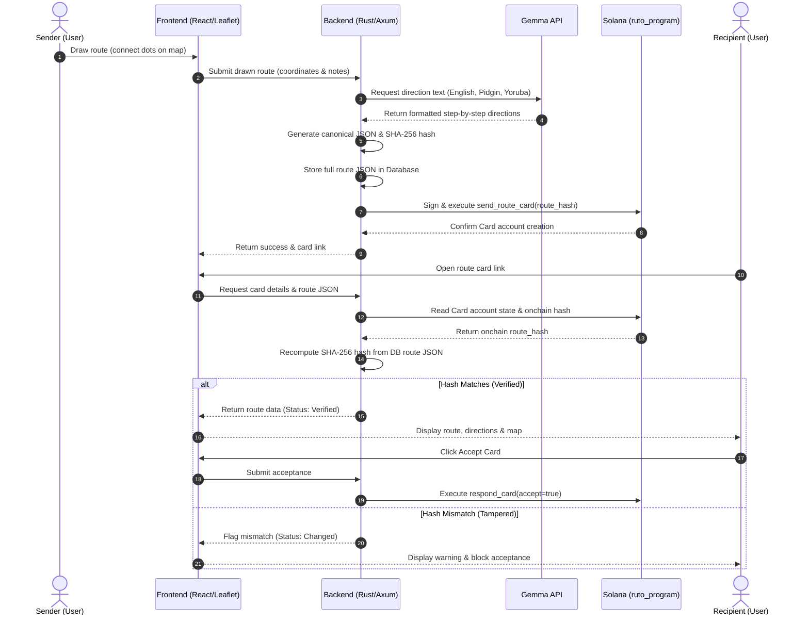

# Ruto

**Draw the way to your friend. Send it as a card.**

Ruto is a campus navigation app built for FUOYE. Instead of describing directions over a voice note ("enter keke at the junction, drop after the filling station..."), you draw the route on a map by connecting dots, and Ruto turns it into clear directions in English, Pidgin or Yoruba. Send it to a friend as a **route card**, and they can check that it arrived unchanged before accepting it.

> Status: hackathon build for Hacktoberfest Hack Day (Ikole-Ekiti x Oye-Ekiti). Runs on Solana **devnet** only. Expect rough edges.

---

## Why Ruto

Google Maps doesn't know how people actually move around campus: the shortcut behind the faculty, the keke park by the gate, "the hostel opposite the food canopy". The people who know those routes are the students. Ruto lets them draw what they know and share it.

## Features

- **Draw a route.** Tap dots on the map and connect them. Snap to known campus places (gates, faculties, Hub, hostels) or add your own.
- **Directions in your language.** Gemma rewrites your route into friendly step-by-step directions in English, Pidgin or Yoruba.
- **Route cards.** Send a drawn route to a friend by handle.
- **Profile cards.** Share a campus business card with another user.
- **Verified before you accept.** Every route is hashed with SHA-256. The hash is recorded on Solana when the card is sent. The recipient's app recomputes the hash before accepting, so a route edited after sending is flagged.
- **No wallet needed.** Users pick a handle and use the app. The protocol manages keys and pays fees.

## How it works

```
 draw route -> canonical JSON -> SHA-256 hash
                    |                 |
         stored in backend DB   written to Solana (ruto_program)
                    |                 |
 recipient opens card -> fetch route -> recompute hash -> compare -> Verified / Changed
```

1. The sender draws dots and notes on the map. Distances and turns are computed from the coordinates.
2. The backend serializes the route in a fixed canonical form (field order, rounded coordinates, trimmed strings, salt), hashes it, and stores the full route in its database.
3. `ruto_program` records the hash in a `Card` account addressed to the recipient's profile.
4. The recipient opens the card. The backend recomputes the hash from the stored route and compares it to the onchain one.
5. If they match, the card shows **Verified** and can be accepted. Otherwise, accepting is blocked.

Gemma only **rewords** the route into directions. It never decides or invents the route.



## Architecture

| Part | Tech |
|------|------|
| Backend | Rust, Axum |
| Frontend | React, Leaflet, OpenStreetMap tiles |
| Directions | Gemma (hosted API) |
| Onchain | `ruto_program`, an Anchor program on Solana devnet |
| Storage | Route JSON and profile details in the backend database |

### `ruto_program`

All instructions are signed and paid for by the backend authority, so users never handle keys.

**Accounts**

- `Config`: holds the authority key.
- `Profile`: seeded by handle. Stores handle, avatar id, a hash of off-chain profile data, and inbox and sent counters.
- `Card`: seeded by recipient profile and index. Stores sender, recipient, kind (Route or Profile), route hash, shared profile, status (Pending, Accepted, Declined) and timestamps.

**Instructions**

- `initialize_config`
- `create_profile(handle, avatar_id, data_hash)`
- `send_route_card(route_hash)`
- `send_profile_card()`
- `respond_card(accept)`

## What goes onchain (and what doesn't)

Solana data is public and permanent, so Ruto keeps it minimal:

- **Onchain:** handles, hashes, counters, card status and timestamps.
- **Never onchain:** coordinates, place names, real names, phone numbers or matric numbers. Those stay in the backend database.

## Trust model

The backend holds the authority key and signs every transaction. That means:

- Ruto proves a route **was not changed after it was sent**, and **when** it was sent.
- Ruto does **not** prove a route is correct, and sender identity is only as strong as the login.
- This is protocol-managed onchain records, not a trustless or decentralized system.

## Getting started

### Prerequisites

- Rust (stable) and Cargo
- Node.js 20+
- Solana CLI and Anchor (for the program)
- A Gemma API key (see the [Gemma quickstart](https://mlh.link/gemma-quickstart))

### Backend

```bash
cd backend
cp .env.example .env   # add GEMMA_API_KEY, SOLANA_RPC_URL, AUTHORITY_KEYPAIR path
cargo run
```

### Frontend

```bash
cd frontend
npm install
npm run dev
```

### Program (devnet)

```bash
cd ruto_program
anchor build
anchor deploy --provider.cluster devnet
anchor test
```

## Project structure

```
ruto/
  backend/        Rust + Axum API (routes, hashing, Gemma, signing)
  frontend/       React app (draw page, cards, inbox)
  ruto_program/   Anchor program (profiles and cards)
  data/           Campus anchor places (campus.json)
```

## Contributing

Ruto is built for Hacktoberfest and welcomes first-time contributors.

- Add or correct a campus place in `data/campus.json`.
- Improve Pidgin or Yoruba direction prompts.
- Fix bugs, add tests, or improve docs.

Look for issues labeled `good first issue`, and read `CONTRIBUTING.md` before opening a pull request. Keep pull requests small and focused.

## Roadmap

- Self-hosted Gemma, so the model is fully under our control
- Live "where am I now" using phone GPS
- Crowd-verified routes (confirmation counts)
- Contributor reputation and leaderboard
- Optional wallet linking for users who want one

## Built by

[idorocodes](https://github.com/idorocodes), with the FUOYE builder community.

## License

MIT
